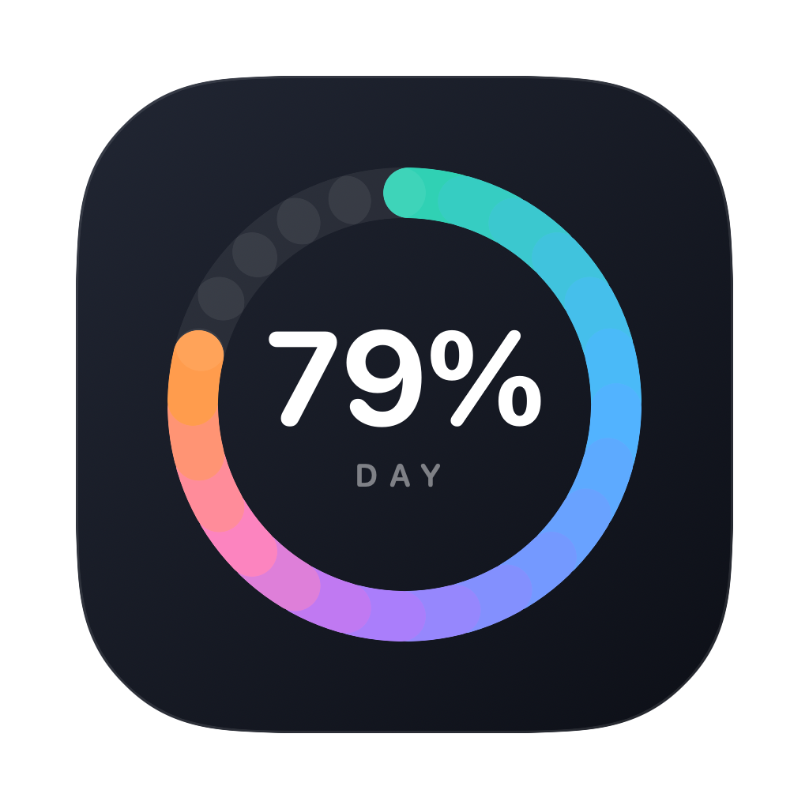
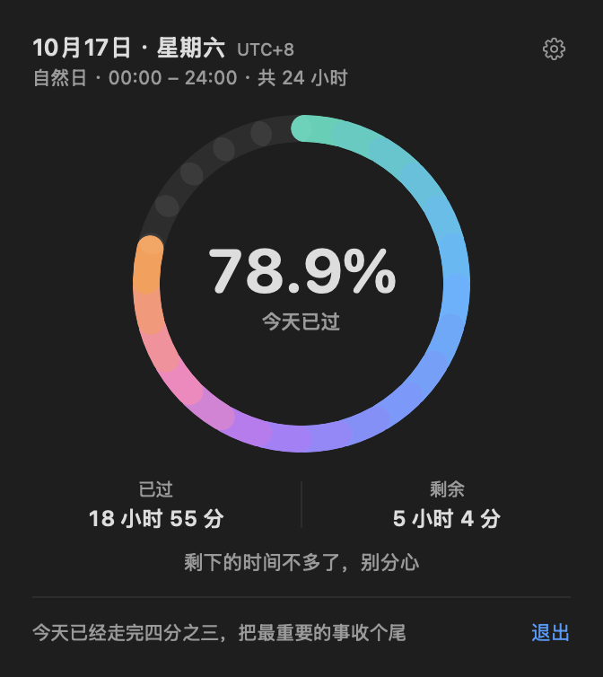
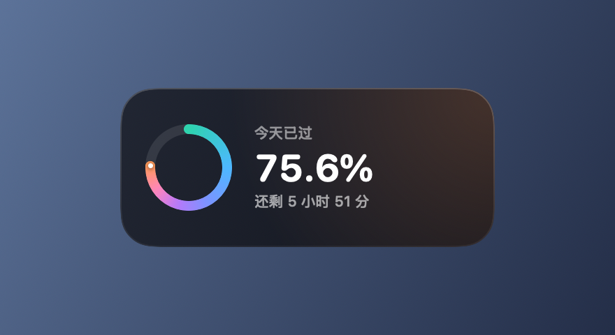
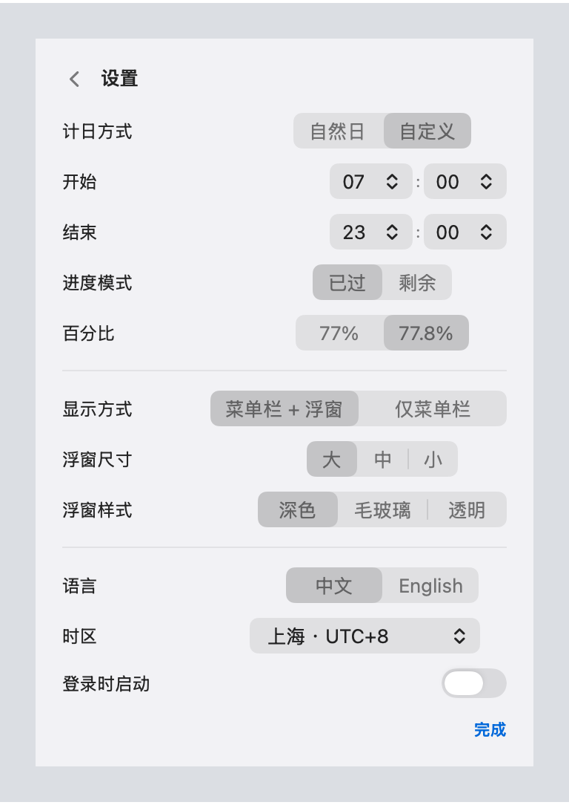
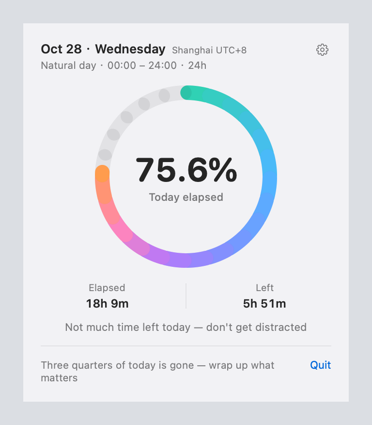
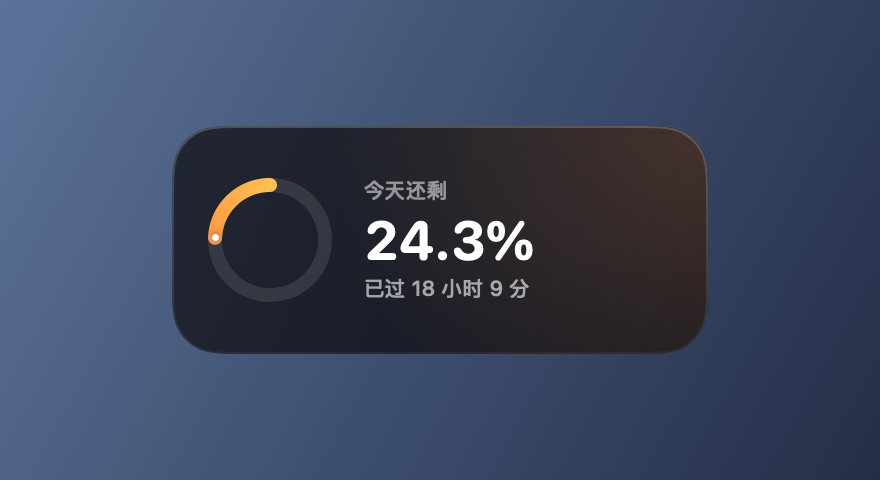
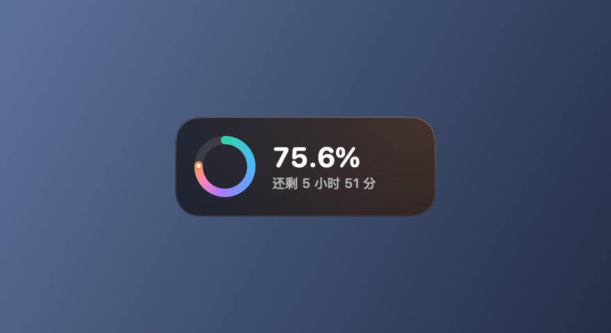
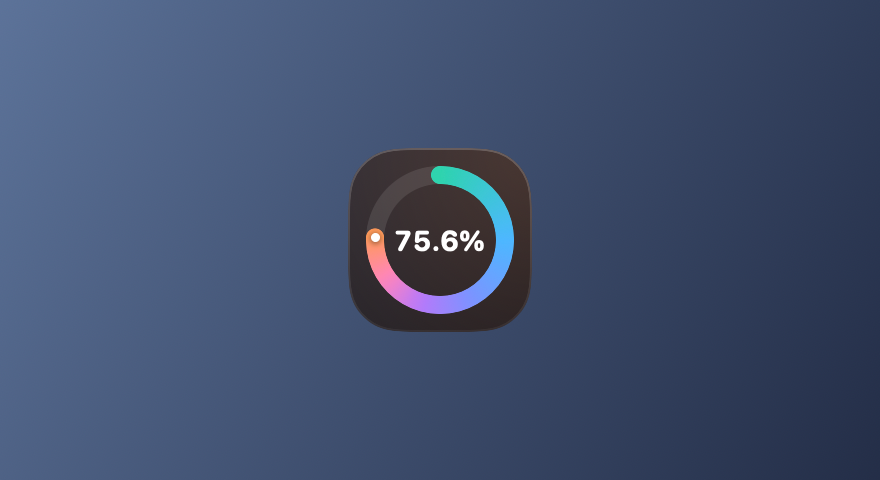
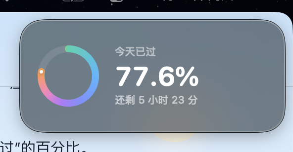

<p align="center">
  
</p>

<h1 align="center">DayProgress</h1>

<p align="center">
  <b>A tiny macOS menu bar app that shows how much of today is already gone.</b><br>
  🌐 <a href="https://ACGpp.github.io/DayProgress/">Website</a> · <a href="README.md">中文</a> · English
</p>

<p align="center">
  
  
  
</p>

## Current release

Latest release: [**v1.2.2**](https://github.com/ACGpp/DayProgress/releases/tag/v1.2.2) (2026-10-28). `main` is the current development branch, including memory improvements, guided packaging and website fixes. Check out the `v1.2.2` tag to build the published source revision.

- **Less memory accumulation:** settings no longer rebuild on every clock tick; menu text updates only when changed, and hidden floating views are released.
- **Guided installation:** [download the DMG](https://github.com/ACGpp/DayProgress/releases/download/v1.2.2/DayProgress-1.2.2.dmg), with an Applications shortcut and bilingual guide, or read the [online installation guide](https://acgpp.github.io/DayProgress/install.html).
- **Menu-bar-only mode:** hide the floating card in Settings while keeping the percentage.

See the [changelog](CHANGELOG.md). Performance measurements use an isolated probe; full-app 24-hour stability is not yet verified. See [measurement details](docs/memory-performance.md).

## Installation

**Requirements:** macOS 13 or later · universal binary (Apple Silicon + Intel) · free and open source (MIT).

### Three steps

1. **Download** `DayProgress-x.y.z.dmg` from [Releases](https://github.com/ACGpp/DayProgress/releases/latest).
2. **Open the disk image.** It includes the app, an Applications shortcut, and a bilingual HTML installation guide. Quit the old version, then drag the app into Applications. Choose Replace to update; preferences are preserved.
3. **Open from Applications.** If blocked, follow Open Anyway below. Eject the disk image after installing.

The alternative ZIP contains the same guide. `SHA256SUMS.txt` provides download checksums. A DMG does not bypass Gatekeeper: the app has no Apple Developer ID signing or notarization.

### First launch: Gatekeeper will block it once

The app is **ad-hoc signed and not notarized**, so macOS blocks the first launch after a download. If that happens:

1. Open **System Settings → Privacy & Security** and scroll down to the DayProgress notice.
2. Click **Open Anyway** and confirm (you may need your login password).
3. Open DayProgress from Applications again.

On macOS 15 and later, right-click → Open may not work; the Open Anyway button is the reliable path.

Terminal alternative (only after verifying the download came from the official Release above):

```bash
xattr -dr com.apple.quarantine /Applications/DayProgress.app
```

> This removes the app's quarantine flag and skips Gatekeeper's check. Change the path if you installed to `~/Applications`; never use it on apps you don't trust.

### After install

DayProgress is a menu-bar-only app (`LSUIElement`) with no Dock icon. The first launch shows a one-time welcome window; close it and the app keeps running in the menu bar at the top-right of the screen.

- **Open the panel:** click the hourglass icon in the menu bar.
- **Quit:** click the menu bar icon → **Quit** at the bottom-right of the panel footer. The floating card's right-click menu also has **Quit DayProgress**.

### Launch at login

After you enable “Launch at login” in Settings, you may need to approve it in **System Settings → General → Login Items**. The app is ad-hoc signed, and some macOS versions may refuse to register it; if the toggle fails, move the app into `/Applications` and try again, or add it manually under Login Items.

### Uninstall

1. If “Launch at login” is on, turn it off first; if the app is already gone, remove the leftover entry in **System Settings → General → Login Items**.
2. Quit from the menu bar panel footer.
3. Drag `/Applications/DayProgress.app` (or `~/Applications/DayProgress.app`) to the Trash.
4. Optionally remove saved settings: `defaults delete com.tree.dayprogress` (if it says the domain doesn't exist, there was nothing saved).

### Troubleshooting

- **Nothing visible after launching — or the icon disappeared?** There's no Dock icon or main window; check the top-right menu bar. The icon can be hidden by the notch or by menu bar managers such as Bartender / Ice. Quit and reopen if needed.
- **“Unidentified developer” or “damaged” warning?** Follow the Gatekeeper steps above and click Open Anyway. Only use the `xattr` command if you're certain the download came from the official Release.
- **It crashes on launch or the architecture is wrong?** Official releases are universal; if you build from source, use `UNIVERSAL=1 ./build.sh` for a release build. Check with `lipo -archs /Applications/DayProgress.app/Contents/MacOS/DayProgress` — it should list `arm64` and `x86_64`.
- **“Launch at login” won't turn on?** The app must be in Applications, and macOS may need approval in System Settings → General → Login Items; ad-hoc signing can make registration fail on some systems.

## Why

Someone on X said it best: **24 minutes is 1/60 of your day.**

1440 minutes a day — 24 of them is 1.67%, and it takes one short scroll to burn one. I built this little app with **DeepSeek-V4-Flash-1017** to make that number visible. It won't manage your time; it just shows it.

## Screenshots

Menu bar panel and floating card:





Settings page (gear icon on the panel):



Chinese / English UI, switchable on the fly:



Progress mode can show the day *remaining* instead of elapsed:



Three sizes and three styles (dark / glass / clear):







## Features

- **Live percentage** in the menu bar (`⏳ 79.0%`), full panel on click.
- **Floating card**: ring + big percentage + time left; always on top, draggable, remembers its position.
- **Menu bar only**: switch to “Menu bar only” in Settings if you prefer a clean desktop without the floating card.
- **Elapsed / remaining mode** — the ring follows the selected value.
- **Chinese / English UI**, switchable in settings.
- **19 time zones** plus "follow system"; the date and “today” follow the chosen zone.
- **Day window**: natural day (00:00–24:00) or a custom range (e.g. 07:00–23:00, overnight supported).
- **Percent precision**: whole numbers or one decimal.
- **Card size / style**: large / medium / small × dark / glass / clear.
- **Launch at login**, all settings persisted locally.
- Checks time every 10 seconds; menu text updates only when changed, with immediate refresh after wake or system-clock changes.

## Build from source

Requires macOS 13+ with Xcode or Command Line Tools (`swiftc`).

```bash
git clone https://github.com/ACGpp/DayProgress.git
cd DayProgress

./build.sh              # current architecture
UNIVERSAL=1 ./build.sh  # universal (arm64 + x86_64)
./install.sh            # copy to /Applications and launch
./test.sh               # clock, update and window-lifecycle checks
./release.sh            # universal DMG + ZIP + SHA256SUMS.txt in dist/
```

Or run it directly: `open build/DayProgress.app`.

GitHub Actions runs checks and builds on pushes to `main` and pull requests. Pushing a matching `v*` tag runs checks and publishes the DMG, ZIP and checksums.

## Development

```
DayProgress/
├── Sources/
│   ├── DayProgressApp.swift   # menu bar entry
│   ├── MenuBarLabel.swift     # update menu text only when changed
│   ├── AppDelegate.swift      # floating NSPanel: size, style, position
│   ├── DayClock.swift         # time window, time zone, percentages, strings
│   ├── Localization.swift     # language / progress mode / precision / zones
│   ├── DayRing.swift          # smooth ring + 24-slot ring + palette
│   ├── FloatingCardView.swift # card UI (3 sizes × 3 styles)
│   ├── PopoverView.swift      # panel: main page + settings page
│   └── LoginItem.swift        # launch at login (SMAppService)
├── Tests/                     # regression checks
├── packaging/                 # bilingual installation guides
├── Tools/MemoryProbe/         # reproducible allocation comparison
├── Tools/MakePreview/         # offscreen previews + app icon
├── docs/                      # README screenshots and icon
├── build.sh / preview.sh / release.sh / install.sh
```

Quick UI preview without clicking the menu bar:

```bash
./preview.sh
```

Debug window (useful for screenshots):

```bash
DAYPROGRESS_DEBUG_POPOVER=1 ./build/DayProgress.app/Contents/MacOS/DayProgress          # main page
DAYPROGRESS_DEBUG_POPOVER=settings ./build/DayProgress.app/Contents/MacOS/DayProgress   # settings page
```

### Notes

- Not notarized — meant for personal use; you may need to allow it manually on first launch (see “First launch” above).
- “Launch at login” expects the app to live in Applications, and macOS may require approval under System Settings → General → Login Items.
- All settings are stored locally in `com.tree.dayprogress` UserDefaults. Nothing is uploaded.

## Credits

- Inspired by a post on X about “24 minutes = 1/60 of your day”.
- Built end-to-end with **DeepSeek-V4-Flash-1017** — from idea to an installable Mac app in one afternoon.
- UI and icon drawn with SwiftUI.

If this makes you glance at the clock a little more often, a Star ⭐️ is appreciated.

## License

[MIT](LICENSE) © 2026 ACGpp
