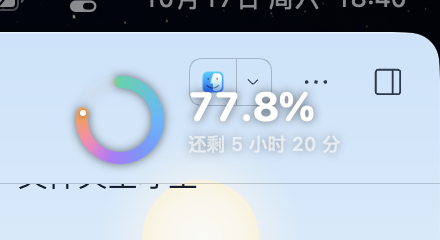

<p align="center">
  
</p>

<h1 align="center">DayProgress · 今日进度</h1>

<p align="center">
  <b>一个 macOS 菜单栏小工具：把“今天过去了多少”变成随时能看见的百分比。</b><br>
  <a href="README.en.md">English</a> · 中文
</p>

<p align="center">
  
  
  
</p>

## 为什么做这个

在 X 上看到一句话：**24 分钟，就是你一天的 1/60。**

一天 1440 分钟，24 分钟刚好是 1/60，也就是 1.67%。一天里能有几个这样的 24 分钟？刷一会儿手机就没了。

于是我用 **DeepSeek-V4-Flash-1017** 写了这个小工具。它不管理你的时间，只是让时间变得可见：抬头看一眼菜单栏，就知道今天溜走了多少。

## 下载

- 到 [Releases](../../releases/latest) 下载最新的 `DayProgress-x.y.z.zip`，解压后把 `DayProgress.app` 拖进「应用程序」。
- 发布包是通用二进制（Apple Silicon + Intel），要求 macOS 13+。
- App 用 ad-hoc 签名、未做公证。首次打开如果被系统拦截：右键 App → 打开，或到「系统设置 → 隐私与安全性」里允许。

## 长什么样

菜单栏 + 桌面浮窗：


设置页（面板右上角齿轮）：


中英文实时切换：


进度模式切成“还剩多少”，环和数字一起反向：


三档尺寸 + 深色 / 毛玻璃 / 透明三种外观：


毛玻璃效果（真实截图）：


透明效果（真实截图）：



## 功能

- **实时百分比**：菜单栏常驻（如 `⏳ 79.0%`），点开是完整面板。
- **桌面浮窗**：环形进度 + 大号百分比 + 剩余时间；置顶、可拖动、位置记住，右击可隐藏。
- **进度模式**：已过 / 剩余，24 格“一天刻度环”会跟着反向点亮。
- **中 / 英文界面**：设置里一键切换，日期、文案、浮窗内容一起变。
- **更多时区**：跟随系统 + 20 个常用时区（上海、东京、伦敦、纽约、洛杉矶…），标题旁显示时区徽标与 UTC 偏移。
- **计日方式**：自然日（00:00–24:00）或自定义时段（如 07:00–23:00，支持跨夜）。
- **百分比精度**：整数（`77%`）或一位小数（`77.8%`）。
- **浮窗尺寸 / 外观**：大 / 中 / 小 × 深色 / 毛玻璃 / 透明。
- **登录时启动**、所有设置自动保存。
- 每 10 秒刷新一次，数值只在变化时重绘。

## 从源码构建

要求：macOS 13+，已安装 Xcode 或 Command Line Tools（`swiftc` 可用）。

```bash
git clone <repo-url>
cd DayProgress

./build.sh            # 当前架构，快
UNIVERSAL=1 ./build.sh  # arm64 + x86_64 通用二进制
./install.sh          # 复制到「应用程序」并启动
./release.sh          # 通用二进制 + 打 zip 到 dist/
```

也可以直接运行：`open build/DayProgress.app`。

CI 在 GitHub Actions 上跑（见 `.github/workflows/build.yml`），打 `v*` tag 时自动发布 Release（`.github/workflows/release.yml`）。

## 开发

```
DayProgress/
├── Sources/
│   ├── DayProgressApp.swift   # 菜单栏入口
│   ├── AppDelegate.swift      # 桌面浮窗（NSPanel）管理：尺寸、样式、位置
│   ├── DayClock.swift         # 计时、时区、百分比、本地化文案
│   ├── Localization.swift     # 语言 / 进度模式 / 精度 / 时区选项
│   ├── DayRing.swift          # 平滑进度环 + 24 格刻度环 + 配色
│   ├── FloatingCardView.swift # 浮窗界面（三档尺寸 × 三种外观）
│   ├── PopoverView.swift      # 下拉面板：主页 + 设置页
│   └── LoginItem.swift        # 登录启动（SMAppService）
├── Tools/MakePreview/         # 离屏渲染预览图与 App 图标（开发用）
├── docs/                      # README 截图与图标
├── build.sh                   # 构建 App
├── preview.sh                 # 渲染预览图 + 图标
├── release.sh                 # 打发布包
└── install.sh                 # 安装到「应用程序」
```

改界面时想快速看效果：

```bash
./preview.sh   # 输出 build/preview/card-*.png、popover-*.png 和 build/AppIcon.png
```

想看真实面板的渲染（会额外打开一个无边框窗口，方便截图）：

```bash
DAYPROGRESS_DEBUG_POPOVER=1 ./build/DayProgress.app/Contents/MacOS/DayProgress          # 主页
DAYPROGRESS_DEBUG_POPOVER=settings ./build/DayProgress.app/Contents/MacOS/DayProgress   # 设置页
```

### 已知限制

- App 未公证，仅适合自用；首次打开可能需要手动放行。
- 「登录时启动」需要 App 位于「应用程序」文件夹。
- 语言 / 时区等设置只存在本机 `com.tree.dayprogress` 的 UserDefaults 里，不上传任何数据。

## 致谢

- 灵感来自 X 上关于“24 分钟 = 一天的 1/60”的帖子。
- 全程与 **DeepSeek-V4-Flash-1017** 结对完成，从想法到可安装的 Mac App 只花了一个下午。
- 界面、图标由 SwiftUI 绘制。

如果它让你多看了几眼时间，欢迎点个 Star ⭐️

## License

[MIT](LICENSE) © 2026 shouzhong
